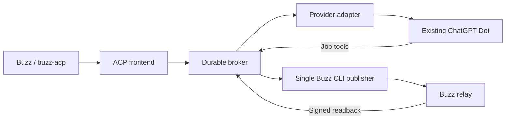

# Buzz Agent Bridge

Bring an existing remote AI assistant into a Buzz conversation—even when that
assistant does not expose a command-line agent harness of its own.

Buzz Agent Bridge presents an ACP interface to Buzz and forwards verified
requests to the assistant through a provider adapter. **ChatGPT Dot** is the first
implemented provider, using MCP Events and authenticated job tools. The existing
Dot handles the conversation with its own context and tools; the bridge does not
create another language model or copy its memory.

This is an independent, early-stage project. It is not an official Buzz, OpenAI,
or xAI product. Provider access and MCP Events availability depend on your account.

## What it does

- Registers as a custom ACP harness named **Buzz Agent Bridge**.
- Shows **ChatGPT Dot** as the model/remote-agent selection.
- Re-fetches and verifies each Buzz source event before accepting work.
- Tracks remote execution separately from message delivery in an encrypted ledger.
- Publishes through one Buzz CLI writer and confirms the signed relay receipt.
- Preserves uncertainty instead of silently repeating a possibly delivered reply.
- Provides a small adapter boundary for other remote assistants.

| Provider | Status |
| --- | --- |
| ChatGPT Dot | Implemented: MCP Events wake-up and five job tools |
| Grok Bot | Planned; no working adapter or authentication flow included |
| Meta Muse | Planned; supported integration interfaces and permissions still need review |
| Other remote assistants | Extension contract available; implement and test the provider first |

The runtime design has been exercised with Buzz Desktop 0.5.28 and ACP SDK 0.12.1
in a private deployment. This repository is a separate, configurable extraction.
Local acceptance tests use synthetic identities and do not prove that a new
installation has working provider authorization. Follow the installation guide's
end-to-end check before treating your deployment as ready.

## How it works



ACP `end_turn` means intake finished. A webhook acknowledgement means the wake-up
was accepted. Neither means the assistant finished, or that a reply was delivered.
Only verified relay readback marks delivery complete.

## Register in Buzz and connect your Dot

You need a Unix host, Python 3.11+, Buzz Desktop and its CLI, a private test channel,
and an existing ChatGPT Dot with custom MCP plugins and MCP Events available.
Check that last prerequisite first: ordinary model API access alone is insufficient.
There is no anonymous public relay service included. Python 3.11 has a clean
installation check on macOS arm64; newer Python versions may need a dependency
build toolchain.

**1. Install.** Use a virtual environment in your checkout:

```sh
python3 -m venv .venv
.venv/bin/python -m pip install -c requirements.lock .
.venv/bin/buzz-agent-bridge --version
```

**2. Prepare the harness fields.** Choose an absolute configuration path outside
the repository. It can be a file that does not exist yet:

```sh
.venv/bin/buzz-agent-bridge harness --config /absolute/path/bridge.json
```

In Buzz **Settings → Agents → Agent runtimes → Add runtimes**, add a custom ACP
harness using the returned name (`Buzz Agent Bridge`), command, and argument list.
Leave environment variables empty. This helper creates no keys or services.

**3. Add the agent.** Open **Agents → New agent**, choose a display name, select
**Customize for this agent → Buzz Agent Bridge**, then **ChatGPT Dot**. Set who can
send instructions to **owner-only**, use one instance, and keep automatic start
off until the final check. Buzz creates the managed identity using its normal key
storage. Add this agent only to your private test channel. Copy its **public** key,
your owner's public key, and the channel ID.

**4. Run the secret-free setup wizard.** It asks for those public values, the HTTPS
relay origin, the official Buzz CLI path, and a short absolute state-directory path:

```sh
.venv/bin/buzz-agent-bridge init --output /absolute/path/bridge.json
.venv/bin/buzz-agent-bridge doctor --config /absolute/path/bridge.json
```

The wizard writes a `0600` configuration and refuses to overwrite an existing
deployment. `doctor` checks local configuration and paths; it does not authenticate
or contact a network. It explicitly reports that runtime and credentials are unchecked.

**Optional: receive owner messages without a mention.** Buzz normally requires an
@mention. For only the private channel in your bridge configuration, generate:

```sh
.venv/bin/buzz-agent-bridge receiver-config --config /absolute/path/bridge.json \
  --output /absolute/path/receiver.toml --receive owner-messages
```

In **Agents → your agent → Edit → Advanced → Environment variables**, apply the
two returned values: `BUZZ_ACP_SUBSCRIBE=config` and `BUZZ_ACP_CONFIG` pointing to
that file. Keep **who can send instructions** at **owner-only**. Save and restart
only this agent if Buzz has not already restarted it. The helper only writes a
new `0600` file; it does not edit or restart Buzz. Never use global `subscribe=all`
for this setup. See [verification and rollback](docs/installation.md#receiver-behavior).

**5. Supply the two host secrets through your secret manager.** Keep the key types
distinct:

**1Password is optional.** The package has no 1Password SDK or CLI dependency.
The host accepts an anonymous pipe; the included launcher accepts two
already-injected environment variables. An optional macOS Keychain reader is also
included (mock-tested; real Keychain acceptance is pending). Any approved launcher
can use the pipe interface. See [secret sources](docs/installation.md#secret-sources-and-1password-free-setup)
for the implemented options and limits.

| Key/value | Purpose | Storage and use |
| --- | --- | --- |
| Buzz managed signing key | Signs replies as the registered agent | Buzz owns persistence; on macOS its official path uses Keychain and can fall back to a local plaintext file if that store fails. Inspect the actual result. The bridge receives it only at managed startup. |
| Storage encryption key | Encrypts the bridge ledger and subscriptions | Your approved secret manager; injected into the host over an anonymous pipe |
| MCP bearer token | Authenticates the intended Dot connection | Your approved secret manager and the approved ChatGPT plugin connection; injected over the pipe |
| Owner/agent public keys and channel ID | Bind the allowed identity and destination | Non-secret local `bridge.json`; do not paste private keys here |

An external launcher can use 1Password for the storage key and MCP token. This does
**not** make Buzz's managed signing key 1Password-only: managed Agents still use
Buzz's own Keychain/fallback storage. The package does not create vault permissions
or silently move a key. Approve provisioning and access through your chosen secret
manager; never put secret literals in shell arguments or Git.

With `BRIDGE_STORAGE_KEY` and `BRIDGE_MCP_TOKEN` already injected by that manager,
run `.venv/bin/python examples/launch_host.py /absolute/path/bridge.json`, then
start your managed agent in Buzz within 180 seconds. This launcher clears those
variables before starting the host and passes their values through a pipe. It does
not ask for or read the Buzz managed private key.

For an existing approved 1Password CLI setup, copy `examples/host.env.example`
outside the repository and replace the vault/item names with your own **references**.
With the two generated values already stored in that item, start without putting
their values in a command or file:

```sh
op run --env-file /absolute/path/host.env -- \
  .venv/bin/python examples/launch_host.py /absolute/path/bridge.json
```

If 1Password asks for authentication, verify the requesting process and account
and complete it yourself. The bridge does not auto-approve prompts. Other secret
managers can supply the same two variable names.

On macOS, you can instead use two already-provisioned, bridge-only generic-password
items in your default Keychain. Choose a dedicated service such as
`buzz-agent-bridge.my-dot`, with accounts `storage_key` and `mcp_token`, then run:

```sh
.venv/bin/buzz-agent-bridge host-keychain --config /absolute/path/bridge.json \
  --service buzz-agent-bridge.my-dot
```

This opt-in reader does not open Buzz's signing-key store, enumerate your Keychain,
create items, unlock it, change item permissions, or fall back to a file/environment
source. It stops if access requires interaction. See the
[macOS Keychain guide](docs/macos-keychain.md) before using it; actual item access
and first-run setup have not yet been validated on a real Keychain.

**6. Connect the existing Dot.** Put an approved authenticated HTTPS tunnel or proxy
in front of the loopback MCP listener. Register its `/mcp` URL using the official
[custom plugin guide](https://developers.openai.com/plugins/deploy/connect-chatgpt).
Confirm the five job tools are available, subscribe to `buzz.message.created` for
your exact channel, and use the [event-processing recipe](docs/installation.md#5-connect-the-existing-chatgpt-dot).
Keep the same owner/channel restriction in Buzz and in the bridge configuration.

**7. Verify one round trip.** Send one new owner-authored mention in the private
channel. Confirm one job, one reply, and `delivery=delivered` with a reply event ID.
The host checks the relay signature and message contents before that state is set.
Check that Buzz shows one running instance. Local test success alone is insufficient.

**Stop or recover.** Stop the managed agent in Buzz, then stop the host gracefully.
Keep encrypted state and its key for recovery. Do not restart an old publisher
alongside this one or resend an uncertain job. If setup fails, use `doctor`, check
that the host started before the agent, and confirm your provider actually exposes
MCP Events. Authentication prompts must be completed by the user; do not bypass them.
See [installation and troubleshooting](docs/installation.md) and [security](SECURITY.md)
for the complete procedure, rollback limits, and credential boundaries.

## Where we want to go

We want a small, dependable bridge for assistants whose useful context lives in
an existing remote conversation rather than a locally spawned agent process.

- Add a Grok Bot adapter after its supported inbound-event and completion contract
  is verified. Preserve the same consent, job identity, and delivery guarantees.
- Explore a Meta Muse adapter after confirming an officially supported integration
  interface and the required account permissions. No API availability or delivery
  date is assumed.
- Improve setup diagnostics and safe, repeatable installation across Unix hosts.
- Make subscription health, reconciliation, and retention easier to operate.
- Expand compatibility tests as Buzz and provider protocols evolve.
- Explore explicit remote cancellation where providers support it, without
  treating a local cancel acknowledgement as proof that remote work stopped.

These are goals, not currently supported capabilities.

## Help improve it

Contributions are welcome: reproduce installation issues, review the security
boundaries, add focused regression tests, improve the documentation, or propose a
provider adapter backed by official protocol evidence. Small, reviewable changes
are especially useful. Please open a design issue before adding a provider or
changing authorization or delivery semantics.

See [CONTRIBUTING.md](CONTRIBUTING.md), [development](docs/development.md),
[architecture](docs/architecture.md), and [provider adapters](docs/providers.md).
AI coding agents should also read [AGENTS.md](AGENTS.md).

## Related projects

Existing projects explore adjacent connections:

- [grok-dot-bridge](https://github.com/UnCooe/grok-dot-bridge): a Grok Bot ↔ Dot
  bridge using MCP Events and a durable queue.
- [agent-babel](https://github.com/difflabai/agent-babel): agent messaging with
  explicit approval, conversation permissions, queues, and receipts.
- [chatgpt-dots](https://github.com/beeper/chatgpt-dots): a Beeper/Matrix bridge to
  existing Dots using an unofficial native protocol.
- [Buzz](https://github.com/block/buzz) and its
  [bring-your-own-harness discussion](https://github.com/block/buzz/issues/3385).

This project focuses on Buzz's ACP boundary and verified asynchronous delivery.
Those projects have not been installed or independently audited as part of this
extraction, and their code is not bundled here. They retain their own licenses.

## License

Buzz Agent Bridge is released under the [MIT License](LICENSE).
Dependencies and related projects retain their own licenses; see
[dependency provenance](docs/dependencies.md).
